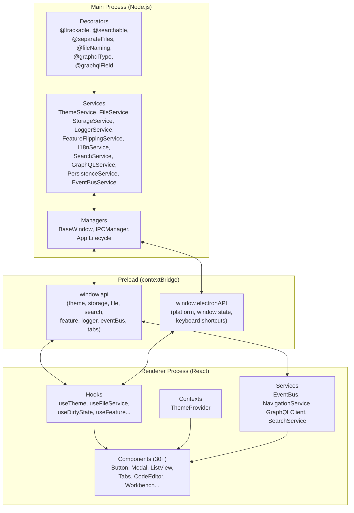

# Architecture Overview

electron-core-ui is structured around Electron's multi-process model: a **main process** (Node.js) handles system operations, and one or more **renderer processes** (React) handle the UI. Communication between them uses IPC via a preload bridge.

## Process Model



## IPC Communication

Three patterns are used for inter-process communication:

### Invoke (Request → Response)

```
Renderer                    Preload                     Main
   │                           │                          │
   │  window.api.theme.list()  │                          │
   │──────────────────────────►│  ipcRenderer.invoke()    │
   │                           │─────────────────────────►│
   │                           │                          │  themeService.listThemes()
   │                           │  ◄────────────────────── │
   │  ◄────────────────────────│  return result           │
   │  Promise<ThemeInfo[]>     │                          │
```

### Events (Main → Renderer)

```
Main                        Preload                     Renderer
  │                           │                           │
  │  webContents.send()       │                           │
  │──────────────────────────►│  ipcRenderer.on()         │
  │                           │──────────────────────────►│
  │                           │                           │  callback(payload)
```

### EventBus (Renderer → Main → Renderer)

```
Renderer A                  Main                        Renderer B
  │                           │                           │
  │  eventBus.emit(event)     │                           │
  │──────────────────────────►│  EventBusService          │
  │                           │  handlers execute         │
  │                           │  broadcast to windows     │
  │                           │──────────────────────────►│
  │                           │                           │  listener(payload)
```

## Detailed Documentation

| Topic | Description |
|-------|-------------|
| [Decorators](./Decorators.md) | `@trackable`, `@searchable`, `@NonSerialised`, `@separateFiles`, `@separateFolders`, `@fileNaming`, `@graphqlType`, `@graphqlField` |
| [GraphQL](./GraphQL.md) | Auto-generated schema from decorators, subscriptions via SSE |
| [Persistence](./Persistence.md) | Single-file and folder-based serialization with decorator-driven structure |
| [Events](./Events.md) | EventBus (main/renderer), Document Events, GraphQL PubSub |
| [Error Handling](./ErrorHandling.md) | Typed error classes with codes and cause chains |

## Service Initialization Order

Services should be initialized in this order in the main process:

1. `logger` — Available immediately (singleton)
2. `getStorageService()` — Lazy singleton, no explicit init needed
3. `i18nService.initialize(path, lang)` — Needs resources path
4. `getThemeService(resourcesPath)` — Needs resources path
5. `initFeatureService(configPath, platform)` — Needs config file path
6. `initFileService(config)` — Needs file extension and format config
7. `initPersistenceService(config)` — Needs persistence config
8. `setupIPC()` — Registers all IPC handlers (call after services are ready)
9. `initializeApp()` — Configures app lifecycle and creates windows
