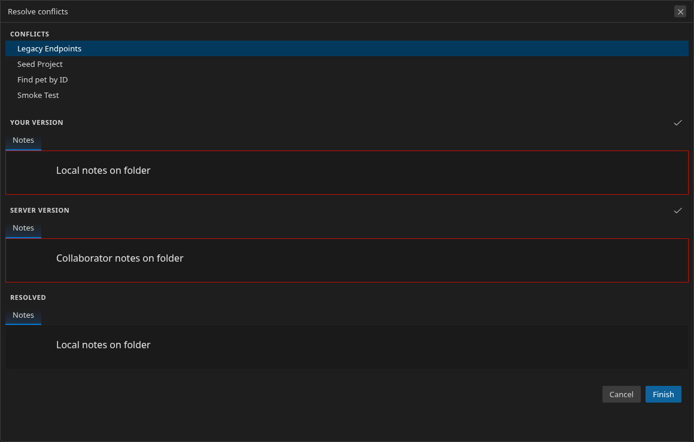
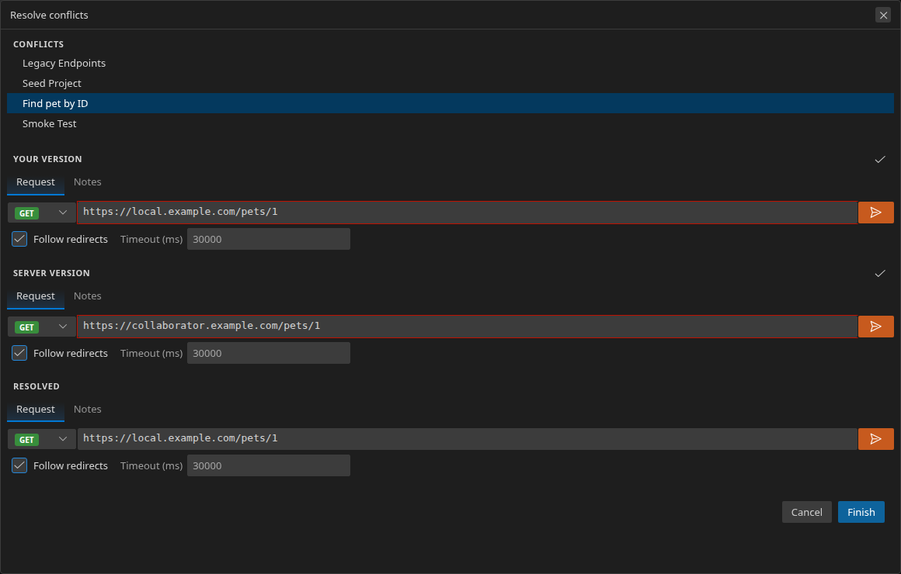

# Git integration

Restorm can track a single-file `.restorm` project that lives inside a git
repository: it shows when you have changes to push or a newer version to pull,
generates a structured commit message for you, and walks you through merge
conflicts entity-by-entity instead of leaving you to hand-edit YAML. Pushing
and pulling reuse the git you already have installed and the credentials it
already knows, so there is no separate login inside Restorm.

Git integration is a **Restorm Pro** feature. See [Pro gating](#pro-gating)
below for what Community sees.

## How it works

Restorm watches the folder of the project file you have open. When that folder
is a git repository, the **GIT** entry appears in the status bar and the
**Git** menu in the title bar becomes active. Everything keys off the *open
project file* — open a `.restorm` file that sits inside a repo and the
integration lights up; close it and the entry goes away.

Under the hood Restorm drives your local `git` (via
[`simple-git`](https://github.com/steveukx/git-js)) for status, stage, commit,
push and pull, and does a lightweight background **fetch-and-compare**
("semi-pull") to notice when the remote has a newer version of your file —
*without* ever merging behind your back. The full plumbing split is documented
for contributors in
[`electron-core-ui/docs/Git/README.md`](../../electron-core-ui/docs/Git/README.md).

If `git` isn't installed or isn't on your `PATH`, Restorm shows a one-time
**"Git isn't installed"** notice instead of the GIT entry, and everything
git-related stays inert.

## The status-bar « GIT » entry

Once a project is open, the status bar shows a **GIT** cell with two codicon
buttons:

- **Push** (the `repo-push` icon) — hover text *"Push to the repository"*.
  Opens the [Push modal](#pushing-the-commit-message-generator). It carries a
  small **pastille** (a dot, never a number) whenever you have something to
  push: uncommitted working-tree changes, or local commits not yet on the
  remote.
- **Pull** (the `repo-pull` icon) — hover text *"Pull from the repository"*.
  Pulls the latest version. It carries its own pastille whenever the background
  semi-pull has found a **newer version of this file on the remote**.

The same two actions are available from the title-bar **Git** menu
(**Git → Push**, **Git → Pull**), wired to the exact same handlers — use
whichever is closer to your hand.

When the semi-pull notices a newer remote version it also raises an **"Update
available"** toast (*"A newer version of this file is available on the
repository."*) with a **Pull now** button, so you find out even if you weren't
looking at the status bar.

## Pushing: the commit-message generator

Clicking **Push** opens the **Push modal**. Restorm has already compared your
in-memory project against the last commit and written a commit message for you
— deterministically, from the structural diff; there is no LLM inside Restorm.

The message is grouped **one line per entity** — request, scenario, folder, or
environment folder — never per field and never per scenario-node move. A single
change becomes a sentence ("Update to the request «Find pet by ID»"); several
changes become an aggregate ("Update to 3 requests, 1 scenario").

The modal has:

- a **language** dropdown — regenerates both the title and body in the chosen
  language on every change. This is independent of the app's UI language, so a
  French-UI user can still write an English commit message.
- an **"apply this language by default"** toggle — when on, the language you
  pick here also becomes the default for future pushes (and stays in sync with
  the same option in **Settings → Git**); when off, your pick only affects the
  message you're editing right now.
- an editable **title** (with a soft 72-character counter — visual only, it
  never blocks) and a multiline **body** — edit either freely before pushing.
- **Cancel** / **Push**. **Push** saves your project to disk, stages the file,
  commits with your message, and pushes to the remote, reporting success or the
  exact git error as a toast.

## Pulling and the 4-panel conflict resolution

**Pull** first saves your project to disk (just like Push — the merge operates
on the file on disk, so any pending edits are persisted before it runs), then
fetches and merges the remote version. When it merges cleanly, the open sidebar
tree and any open editor tab **refresh in place** to the pulled content — no
manual reopen — with your tabs, so you immediately see what you pulled. When the
remote and your local copy changed the *same* entities, Restorm opens the
**conflict-resolution view** instead of leaving conflict markers in your file.

If you have local edits that haven't been pushed yet, git won't merge remote
changes on top of them: the pull reports the git error as a toast and your
unsaved work is left untouched — push your changes first, then pull.

The view is laid out left to right:

1. **Conflict list** (shown only when more than one entity conflicts) — one row
   per genuinely-conflicting entity. An entity that was added on only one side
   is merged in automatically and never appears here. Select a row to resolve
   it; the three panels to the right update to that entity.
2. **Your version** (user / "ours") — read-only.
3. **Their version** (server / "theirs") — read-only.
4. **Resolved** — the editable result you're building.

Each panel renders the entity in **its real editor** — an HTTP request shows
the HTTP request view, a scenario shows the scenario view, a folder shows the
folder view, and so on for every protocol (HTTP, auth, GraphQL, gRPC, SOAP,
WebSocket, OData). The user and server panels are the normal editors made
**read-only** (you can scroll and select, but not type), so a conflict panel is
always a faithful, static snapshot — it never opens a live connection or starts
a server, even if that same request happens to be connected in a real tab.

**Resolving a conflict:**

- **Start from a side.** Each read-only panel has a **"use this version"**
  header button — click it to copy that side wholesale into the **Resolved**
  panel, then tweak from there. You don't have to start from scratch.
- **Field-diff highlighting.** The specific fields that differ between your
  version and theirs are outlined in the same red border Restorm uses for
  field errors, on the two read-only panels — so you can see *what* actually
  diverged (a URL, a header block, the notes) at a glance instead of comparing
  by eye. When a single field differs, the panels also open on **that field's
  tab** for you.

  

- **Edit the resolved copy** freely — it's the live editor, not a text blob.
- **Per entity.** Resolve each conflicting entity in turn from the list; the
  Resolved panel you build for each is remembered.
- **API documentation resolves itself.** An environment folder's API
  documentation is never a manual pick: Restorm chooses the most recent version
  automatically by the `api.version` number recorded in the file (falling back
  to the newer commit's timestamp when the versions are equal or absent), and
  applies that winner independently of whatever you chose for the entity's other
  fields.

**Finishing:** confirming writes the merged project and commits the merge.
**Cancelling aborts the merge** (`git merge --abort` under the hood) and leaves
your local work exactly as it was — nothing is half-applied.

> Saved quick-configs currently merge whole-config (correct and lossless), but
> aren't yet individually pickable inside this view — an interactive
> per-quick-config picker is a planned follow-up.

## Background pull checks (semi-pull) and settings

Restorm periodically checks whether the remote has a newer version of your open
file — a **fetch-and-compare only**, never an automatic merge. It runs on three
triggers: a debounced watch on the repo's `.git` refs, an immediate check when
you open a file, and a periodic timer you control.

**Settings → Git:**

- **Automatic pull-check frequency** — how often the periodic check runs.
  Presets: **15 minutes / 30 minutes / 1 hour / 4 hours / 12 hours / 24 hours /
  Off**. Default **1 hour**.
- **Apply the commit-message language by default** — the same toggle as in the
  Push modal (see above). The commit-message *language* itself defaults to
  **English** and is chosen in the Push modal.

## Authentication

Restorm does **not** manage git credentials. Push and pull run your local git,
which uses whatever credential helper, SSH key, or token you've already set up.

> **If `git push` works in your terminal for this repository, it works in
> Restorm.**

There's no separate login, token field, or credential prompt inside Restorm —
set the remote up once in your terminal (HTTPS token, SSH key, credential
manager, …) and Restorm rides on it.

## Driving git from an AI agent (MCP)

The same commit and pull flows are available to an AI agent over Restorm's MCP
server, as **Restorm Pro** tools (a Community agent gets the standard Pro
refusal). They mirror the UI exactly — the agent drives the same diff, message,
and merge engine you do:

- **`git_commit_push`** — step 1 of 2. Computes the structural diff since the
  last commit and returns a review token, the generated commit `title`/`body`,
  and the per-entity changes (with before/after snapshots). **Nothing is
  written yet.**
- **`git_confirm_push`** — step 2 of 2. Confirms the review token and actually
  commits + pushes, optionally overriding the generated `title`/`body`. It
  refuses if the project changed since the review (so the agent always commits
  what it reviewed).
- **`git_pull`** — pulls. On a clean pull returns `{ pulled: true }`; on a
  conflicted pull returns the list of conflicting entities plus a resolution
  token.
- **`git_resolve_conflicts`** — finishes a conflicted pull: given the resolution
  token and a pick (`"ours"` or `"theirs"`) for every listed conflict, writes
  the merged project and commits it. (v1 is pick-a-side only — no free-form
  field edits through this route.)

## Pro gating

Git integration is gated behind the **`git.client`** Pro capability. The status
bar and title-bar Git menu are always *visible* once a project is open, but
their state depends on three cases:

- **Restorm Pro, inside a git repo** — fully enabled.
- **Restorm Pro, but the open folder isn't a git repo** — locked with an
  informational message, *"Initialize your git folder to use this feature."*
  (no "subscribe" link — there's nothing to buy, you just need to `git init`).
- **Community** — locked with the standard Pro upsell (a subscribe link),
  regardless of whether the folder is a repo.

The **Settings → Git** rows follow the same capability gate.
